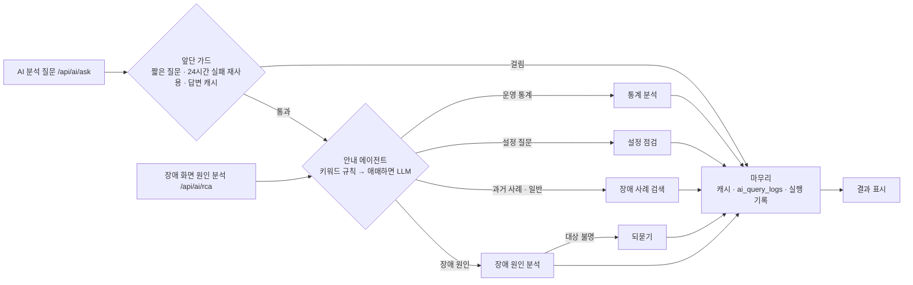
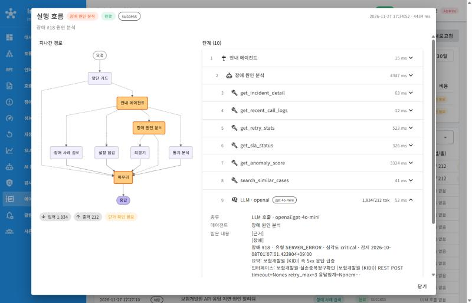

# Interface Hub

> 보험사 외부 인터페이스를 한 곳에서 **등록 · 실행 · 감시 · 재처리 · 분석**하는 통합 관제 플랫폼.

흩어진 REST/SOAP/MQ/Batch/SFTP 연동을 하나의 UI 로 모으고, 실시간 모니터링·자동 장애 감지·운영자 재처리·AI 에이전트 기반 분석(통계·설정·과거 사례·장애 원인)까지 한 화면에서 처리합니다.

---

## 핵심 기능

| 구분 | 기능 | 상태 |
|---|---|---|
| F1 | 인터페이스 등록·실행 (REST / SOAP / MQ / Batch / SFTP, Cron, AES-GCM 시크릿) | ✅ |
| F2 | 실시간 모니터링 (WebSocket 라이브 + ApexCharts 시계열·히트맵) | ✅ |
| F3 | 장애 자동 감지·분류 (Timeout/Auth/Format/5xx) + Slack·Email + in-app toast/뱃지 + **인터페이스별 음소거·채널 토글** | ✅ |
| F4 | 로그 검색 + 재처리 (단건 ↻ / 일괄 / lineage 체인) + 상세 다이얼로그 | ✅ |
| F5 | 성능 관리 (p50/p95/p99 백분위, TPS, Slow Top 10) | ✅ |
| F6 | SLA 리포트 (가동률 / 응답시간 vs 목표) | ✅ |
| F7 | AI 분석 — 기능별 에이전트(LangGraph + LangChain): 통계 · 설정 · 과거 사례(TF-IDF RAG) · **장애 원인 분석**, LLM 없으면 Fallback | ✅ |
| F9 | 에이전트 실행 기록 (백오피스) — 요청별 실행 흐름·단계·모델·토큰·비용 | ✅ |
| F8 | Ingest API — 외부 시스템이 자기 호출 결과를 보고하는 통로 | ✅ |

## 에이전트 구성

Interface Hub 의 AI 분석은 요청을 **안내 에이전트**가 받아 기능별 에이전트에게 나눠 맡기는 구조입니다.
에이전트 연결은 LangGraph, 모델 호출·도구·검색은 LangChain 으로 만들었습니다 (`backend/app/agents/`, 구성 `backend/config/agents.yaml`).



| 에이전트 | 하는 일 | 쓰는 도구 | 끝내는 기준 | 모델 |
|---|---|---|---|---|
| 안내 에이전트 | 장애 화면 진입이면 원인 분석, 아니면 기존 키워드 점수로 분류. 점수 0 이거나 1·2위 동점일 때만 LLM 분류 1회 | - | 경로 1개 결정 (LLM 실패 시 규칙 결과) | fast |
| 통계 분석 | 최근 7일 운영 통계 표만 근거로 답함 | `get_ops_stats` | 수치 인용 답 / "제공된 통계로는 답할 수 없음" | balanced |
| 설정 점검 | 등록된 인터페이스 메타 표만 근거로 답함 (시크릿 값 없음) | `get_interface_config` | 표의 사실로 답 / "등록된 정보 내에 없음" | fast |
| 장애 사례 검색 | 해결된 과거 장애 Top-K 로 원인 가설·조치, `[#ID]` 인용 | `search_similar_cases` (TF-IDF `BaseRetriever`) | 유사도 < 0.05 면 LLM 없이 "찾지 못했습니다" | balanced |
| 장애 원인 분석 (신규) | 장애·호출 로그·재시도·SLA·이상 점수·과거 사례로 원인 가설 1~3개와 점검 순서 제안 | `find_rca_target` `get_incident_detail` `get_recent_call_logs` `get_retry_stats` `get_sla_status` `get_anomaly_score` `search_similar_cases` | 근거 인용 답 / 대상 불명 → 되묻기 / 근거 없음 → LLM 없이 "근거 부족" | top |

- 모델은 `.env` 의 `AGENT_MODEL_FAST/BALANCED/TOP`("제공사:모델" 목록)으로 정하고, 비우면 `AI_MODEL` → 제공사 기본 모델을 씁니다. 제공사 대체 순서는 기존 `AI_PROVIDER` / `AI_FALLBACK_CHAIN` (Mistral → Anthropic → OpenAI → HF, LangChain `.with_fallbacks`).
- 기능 에이전트는 "정해진 도구 호출 → LLM 1회" 노드입니다. 제공사 체인에 tool-calling 을 못 하는 HF 가 있고 작은 모델의 도구 선택이 불안정해, 도구 선택을 LLM 에 맡기지 않았습니다. 도구·LLM 호출 수는 `max_steps` 로 제한합니다.
- LLM 이 없으면(키 없음) 통계·설정은 표를 그대로, 사례는 템플릿 답, 원인 분석은 근거 요약 + 점검 힌트로 답합니다.

### 에이전트가 하는 일 / 사람이 하는 일

| 에이전트가 함 | 사람이 승인하거나 정해진 코드가 함 |
|---|---|
| 통계·설정 설명, 과거 사례 요약, 원인 가설과 점검 순서 제안 | 인터페이스 실행·재처리(단건/일괄/관련 호출), 장애 해결 처리, 음소거, 시크릿 조회, 알림 발송, 사용자·알림 룰 관리 — **에이전트 도구 목록에 없음** (`config/agents.yaml` `forbidden_tools`, `tests/test_agent_tools_guard.py` 가 검사) |
| | 장애 감지·묶기(detector), 스케줄러, SLA 계산, 비밀 만료 검사, 감사 로그, IsolationForest 이상 탐지 — 정해진 코드 그대로 (에이전트는 읽기 전용 도구로만 사용) |

## 실행 기록 (백오피스)

요청 한 건마다 어떤 에이전트가 어떤 순서로 일했는지, 단계별 입력·결과·모델·토큰·비용을 백오피스 `/agent-runs` (메뉴 "에이전트 실행 기록", ADMIN·VIEWER)에서 볼 수 있습니다. 장애 화면의 원인 분석 결과에서도 바로 이동합니다.



> 위 화면은 LLM 키가 없는 검증 환경에서 **채팅 모델만 가짜(응답 usage 고정값)로 바꿔** 찍었습니다. 환율(`USD_KRW_RATE`)을 비워 두어 비용은 "단가 확인 필요"로 표시됩니다.

- 기록 테이블: `agent_runs`, `agent_steps` (기존 `ai_query_logs` 는 그대로 두고 `ai_query_logs.run_id` 로 연결)
- 토큰은 LLM 응답의 `usage_metadata` 그대로 기록 (HF 처럼 주지 않으면 "토큰 미제공", 어림하지 않음)
- 비용(원) = 토큰 × 모델 단가(`backend/config/llm_prices.yaml`, 확인 날짜 2026-11-27) × 환율(`USD_KRW_RATE`). 단가나 환율을 모르면 NULL → "단가 확인 필요"
- 요약은 200자로 자르고 이메일·전화번호·키·토큰을 가려서 저장

## 전환 전후 비교

같은 평가셋(`backend/eval/agent_eval_set.yaml`, 14문항 + 전환 후 RCA 2문항)으로 에이전트 구조로 바꾸기 전과 후를 같은 데이터·같은 시점에 비교했습니다 (LLM 키 없는 fallback 모드).

| 항목 | 전 | 후 | 메모 |
|---|---|---|---|
| 정답(intent·outcome) 적중률 | 14/14 | 14/14 | 경로(route) 적중 16/16 (신규 필드) |
| 평균 응답 시간 | 47ms | 65ms | 그래프 실행 + 실행 기록 저장 비용 (+18ms) |
| 요청당 평균 토큰 | 기록 없음 | 0 (LLM 미호출) | 전에는 usage 를 버림. 후에는 응답 값 그대로 기록 |
| 요청당 평균 비용(원) | 기록 없음 | 0 | 환율 미확인 → LLM 호출 시 "단가 확인 필요" |
| 거절·되묻기·찾지 못함 정확도 | 2/2 | 2/2 | 되묻기는 테스트로 확인 |

자세한 결과: `docs/agent-migration/before.md`, `docs/agent-migration/after.md` · 다른 프로젝트용 교훈: `docs/agent-migration/lessons.md`

## 실행 방법 (에이전트 관련 추가분)

```bash
# 1) 환경 변수: backend/.env.example 의 "에이전트" 항목 이름을 backend/.env 에 채웁니다 (비워도 동작)
# 2) 기록 테이블: 백엔드 기동 시 create_all + 데모 마이그레이션이 agent_runs/agent_steps 와 ai_query_logs.run_id 를 만듭니다
docker compose up -d --build
# 3) 테스트 (라우터 분기, 에이전트별, 위험 도구 검사, 실행 기록, 백오피스 권한 포함)
docker compose exec -e DATABASE_URL=sqlite+pysqlite:///:memory: backend pytest -q tests
# 4) 평가셋 (실행 중인 백엔드 대상)
docker compose exec backend python eval/run_agent_eval.py --phase after
```

| 환경 변수 | 설명 |
|---|---|
| `AI_PROVIDER` / `AI_FALLBACK_CHAIN` | 모델 제공사와 대체 순서 (기존 변수 그대로) |
| `AGENT_MODEL_FAST` / `AGENT_MODEL_BALANCED` / `AGENT_MODEL_TOP` | 수준별 모델 ("제공사:모델" 목록, 비우면 `AI_MODEL`) |
| `ROUTER_LLM_FALLBACK` | 1: 규칙이 애매하면 LLM 분류 / 0: 규칙만 |
| `AGENT_MAX_STEPS` / `AGENT_RECURSION_LIMIT` | 에이전트 단계 한도 / 그래프 전체 한도 |
| `AGENT_TRACE_ENABLED` | 실행 기록 켜기 |
| `USD_KRW_RATE` | 비용 계산 환율 (비우면 비용 NULL) |

## 5종 프로토콜 어댑터

| 프로토콜 | 동작 | 비고 |
|---|---|---|
| **REST** | ✅ 실호출 (httpx) | 4xx/5xx 자동 분류 |
| **SOAP** | ✅ 실호출 (httpx + XML body) | WSDL 파싱은 추후 |
| **SFTP/FTP** | ✅ 실호출 (paramiko, atmoz/sftp 컨테이너) | LIST · GET · PUT 3종 op |
| **Batch** | ✅ 시뮬 (파일 픽업 → 처리 → 결과 업로드) | records/errors/duration 반환 |
| **MQ** | ✅ Redis LIST 시뮬 (BLPOP) | 시드에서 40개 메시지 prepopulate |

## 아키텍처

```
┌──────────────┐  HTTP/WS    ┌──────────────────────┐  REST/SOAP   ┌──────────────┐
│ Vue 3 + Vite │ ◀─────────▶ │ FastAPI (Python 3.12) │ ◀─────────▶ │ 외부 기관 API │
│ Vuetify 3    │             │  · CRUD / Scheduler   │  SFTP/MQ    │ KIDI·KCIS·   │
│ ApexCharts   │             │  · WebSocket Live     │             │ 심평원·KFTC  │
└──────────────┘             │  · Detector·Notifier  │             └──────────────┘
                             │  · AI Agent(LangGraph)│
                             └─────────┬─────────────┘
                                       │
                          ┌────────────┴────────────┬─────────────┐
                          │                         │             │
                  PostgreSQL 15               Redis 7        atmoz/sftp
                  (5 핵심 테이블)               (MQ 큐·캐시)   (SFTP 서버)
                  + 에이전트 실행 기록
```

5개 핵심 테이블: `interfaces` · `call_logs` · `incidents` · `sla_targets` · `vector_cases` (`vector_cases` 는 FAISS 용으로 만들어 두었지만 쓰지 않음 — 검색은 TF-IDF).
에이전트 실행 기록: `agent_runs` · `agent_steps` (+ 기존 `ai_query_logs.run_id`).

## 빠른 시작 (Docker)

```bash
# 1) 환경 변수 준비
cp backend/.env.example backend/.env
# (선택) AI 사용 시 OPENAI_API_KEY, Slack/SMTP 값 채우기 — 안 채워도 fallback 모드로 동작

# 2) 전체 스택 기동 (postgres / redis / sftp / backend / frontend)
docker compose up --build

# 3) 시드 데이터 적재 — 처음 한 번
docker compose exec backend python -m app.scripts.seed_demo
# → 14 인터페이스 + ~12k 호출로그 + 장애 6건 + Redis 큐 40개 메시지

# 4) 접속
#   · Frontend  http://localhost:5173
#   · Backend   http://localhost:8000/docs   (Swagger)
#   · Health    http://localhost:8000/health
```

## 페이지 구성 (사이드바)

| 메뉴 | 내용 |
|---|---|
| 대시보드 | KPI 4종 + 호출량/응답시간 6시간 차트 + LIVE 피드 + **시간대×인터페이스 히트맵** |
| 인터페이스 | 14건 CRUD + ▶ 즉시 실행 + 프로토콜·기관·활성 필터 |
| 호출 로그 | 12k+ 검색 (상태/프로토콜/키워드/실패만) + ↻ 단건/일괄 재처리 + **👁 상세 다이얼로그** + 🌿 lineage 체인 |
| 장애 | 미해결 카운터 + 상태 칩 + 원인/조치 이력 + 수동 해결 처리 + **원인 분석 에이전트** |
| 성능 관리 | p50/p95/p99 백분위 + TPS·p95 시계열 + 가장 느린 호출 Top 10 |
| SLA | 가동률 / 평균 응답 vs 목표 (월/분기) |
| AI 분석 | 안내 에이전트가 통계 · 설정 · 과거 사례 · 원인 분석 에이전트로 분기, LLM 없으면 Fallback |
| 에이전트 실행 기록 | 요청 목록 · 실행 흐름 그림 · 단계별 입력/결과/모델/토큰/비용 · 에이전트·모델별 사용량 (ADMIN·VIEWER) |

## Ingest API (다른 시스템에서 호출 결과 보고)

Hub 가 직접 호출하지 않고 다른 내부 시스템(영업/청구/심사) 이 외부 기관과 통신한 결과도 중앙 집계할 수 있습니다.

```bash
curl -X POST http://localhost:8000/api/call-logs/ingest \
  -H "Content-Type: application/json" \
  -H "X-Ingest-Key: $INGEST_KEY"   # backend/.env 의 INGEST_API_KEY 미설정이면 생략 가능
  -d '{
    "interface_id": 1,
    "status": "SUCCESS",
    "duration_ms": 412,
    "http_status": 200,
    "request": {"endpoint": "...", "from": "sales-system"},
    "response": {"body": {"ok": true}}
  }'
```

→ `triggered_by="ingest"` 로 표시되며 임계값 감지·WebSocket 라이브에 동일하게 반영.

## 디렉터리

```
backend/
  app/
    core/          config · DB · AES-GCM · WebSocket · KST 시간
    models/        SQLAlchemy 5종 + reprocessing/error 컬럼
    schemas/       Pydantic 입출력
    api/routes/    interfaces · executions · call_logs · incidents · sla · performance · ai · monitoring
    agents/        LangGraph 그래프 · 안내 에이전트 · 기능 에이전트 노드 · LangChain 도구/리트리버 · LLM 어댑터 · 실행 기록
    services/      executor (REST/SOAP/SFTP/Batch/MQ) · scheduler · detector · notifier · ai/{anomaly,rag,intent,context,cache,llm}
    scripts/       seed_demo.py — 보험사 현실 시드
  config/          agents.yaml (에이전트 구성) · llm_prices.yaml (모델 단가)
  eval/            에이전트 전후 비교 평가셋 + 실행기
  tests/           pytest (security, executor classifier, 에이전트 라우터·흐름·도구 검사·실행 기록·백오피스)
fixtures/sftp/upload/   ← atmoz/sftp 마운트, 데모 CSV 3종

frontend/
  src/
    api/           Axios + WebSocket 구독
    plugins/       Vuetify 테마
    utils/         포매터 (KST)
    views/         Dashboard · Interfaces · Logs · Incidents · Sla · Performance · AiAssistant · AgentRuns
    stores/        Pinia 라이브 스토어
```

## 구현 하이라이트

- **재처리(Reprocessing)**: `parent_log_id` 컬럼으로 lineage 추적, `POST /retry` 단건 + `POST /bulk-retry` 필터 일괄 + `GET /chain` lineage 트리
- **에러 캡처**: 실행 시 `traceback.format_exception` 으로 풀 스택 + 응답 헤더 `call_logs.error_trace` 에 저장 → 운영자가 ELK 안 가도 원인 파악
- **시간대**: PG 세션 timezone `Asia/Seoul`, Python `now_kst()`, APScheduler KST cron, 프론트 로컬 포맷터 일관 적용
- **AI fallback**: LLM 키가 없으면 sklearn TF-IDF char-ngram 으로 incident 검색 + 템플릿 응답, 통계·설정은 표 그대로, 원인 분석은 근거 요약 → 평가관 PC 에서도 시연 가능
- **AI 에이전트**: LangGraph 그래프 + LangChain 도구(읽기 전용 세션으로 쓰기 차단) + 실행 기록(토큰은 응답 usage 그대로, 비용은 공식 단가 × 환율)
- **Ingest API**: 사이드카/SDK 도입 없이도 다른 시스템 호출 결과 수집 가능, 임계값 감지·라이브 broadcast 동일 적용

## 테스트 / CI

GitHub Actions 가 push/PR 마다:
1. backend ruff lint + pytest (`tests/` 전체 — sqlite 메모리 DB, 네트워크·Redis 없이 가짜 채팅 모델로 에이전트 흐름 검증)
2. frontend type-check + production build
3. backend / frontend Docker 이미지 빌드

## 보안 메모

- `auth_secret` 컬럼은 평문이 아니라 **AES-GCM(256-bit) 암호화 후 base64** 로 저장 (`app/core/security.py`)
- 운영 배포 시 반드시 `SECRET_KEY` 를 `python -c "import os,base64;print(base64.b64encode(os.urandom(32)).decode())"` 로 새로 생성
- `INGEST_API_KEY` 설정하면 Ingest API 가 헤더 검증 (미설정 시 open)
- **계정 보안 (금감원 전자금융감독규정 권고)**
  - 비밀번호 정책: 8자 이상 + 영문·숫자·특수문자 모두 포함, 사용자명·직전과 동일 금지
  - 5회 연속 로그인 실패 시 30분 자동 잠금 (HTTP 423 LOCKED), ADMIN 즉시 해제 가능
  - 관리자 발급 임시 비밀번호 / `reset-password` 시 `must_change_password=True` → 첫 로그인 강제 변경 다이얼로그
  - 로그인 성공/실패/잠금/해제/비밀번호 변경 모두 `audit_logs` 자동 기록
  - 임계치는 `LOCKOUT_THRESHOLD` / `LOCKOUT_MINUTES` / `PASSWORD_MIN_LENGTH` / `PASSWORD_REQUIRE_COMPLEXITY` env 로 조정
- **세션 무효화** — JWT 가 stateless 임에도 즉시 폐기 가능
  - `users.session_version` 카운터 + JWT payload `sv` 비교 → 불일치 시 401 (블랙리스트 테이블/cleanup cron 불필요)
  - `/auth/logout` 본인 모든 활성 세션 종료 (다른 탭 포함), `/users/{id}/force-logout` (ADMIN) 강제 폐기 — 토큰 탈취·퇴사·권한 회수 시 즉시 격리
  - 비밀번호 변경 시 자동 +1 → 옛 토큰 무효화, 응답에 새 토큰 동봉 (UX 끊김 없음)

## Contact
박수산 · fasosan@gmail.com